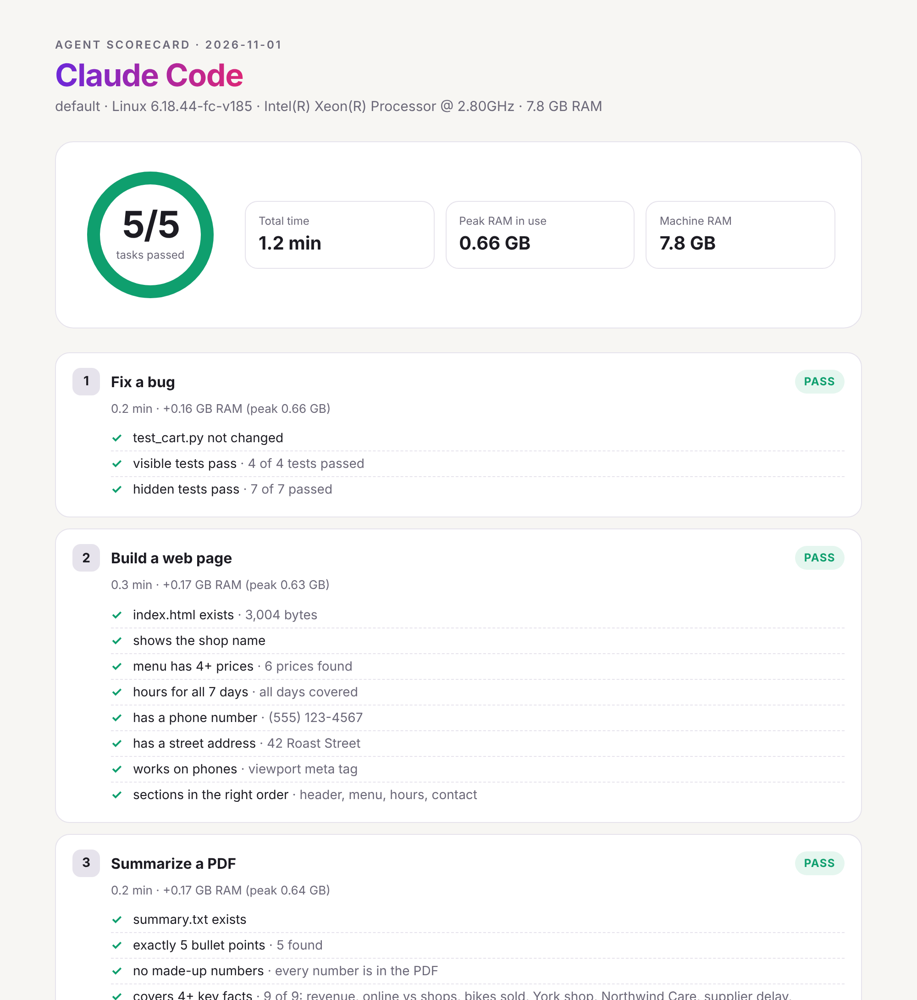

# Agent Scorecard

**Test any AI coding agent on your own computer. 5 real tasks, scored by code.**

[](https://github.com/YOUR-USERNAME/agent-scorecard/actions/workflows/ci.yml)


[](LICENSE)

<picture>
  <source media="(prefers-color-scheme: dark)" srcset="docs/report-dark.png">
  
</picture>

<sub>An example report: Claude Code in auto mode on a Linux cloud machine.</sub>

Big benchmarks run on big servers. You want to know something simpler: **will this agent, with
this model, do real work on my machine?** Agent Scorecard answers that in about 10 minutes.

- **Your machine, your setup.** It runs on your laptop with the model and settings you actually use.
  It records time and RAM, so you can see what a local model costs your computer.
- **Scored by code, not by another AI.** Hidden tests, locked test files and a no-made-up-numbers
  check. An agent can't pass by gaming the visible tests.
- **Works with any agent.** Command-line agents run on their own. Chat apps and IDE agents run by
  hand, with a built-in timer.

## Quick start

You need Python 3.9 or newer. There is nothing to install.

```bash
git clone https://github.com/YOUR-USERNAME/agent-scorecard
cd agent-scorecard
python -m scorecard selftest          # checks the checkers on your machine
python -m scorecard run --agent "Hermes Agent" --model "qwen3-coder"
```

On Windows, use `py` instead of `python` if needed.

The run creates a fresh folder in `~/agent-scorecard-runs/`, walks you through the 5 prompts,
and opens a report when it's done.

## The 5 tasks

| # | Task | What it tests | How it's checked |
|:-:|---|---|---|
| 1 | **Fix a bug** | Debugging | Visible tests, 7 hidden tests, and the test file must stay unchanged |
| 2 | **Build a web page** | Front-end | Shop name, 4+ prices, hours for all 7 days, phone, address, mobile support, section order |
| 3 | **Summarize a PDF** | Reading | Exactly 5 bullets, 4+ key facts, and **every number must appear in the PDF** |
| 4 | **Totals from a CSV** | Tool use | Each customer's paid total and the grand total, refunds left out |
| 5 | **Refactor messy code** | Code quality | Same output on 302 hidden inputs, test file unchanged, at least 20% shorter |

The prompts are plain, like something you'd type on a normal day. You can read them with
`python -m scorecard tasks` or in each `tasks/*/task.json`.

## How scoring works

- Every run starts from **fresh copies** of the task files, outside this repo, so the agent
  can't see the hidden tests or the reference solutions.
- A task passes only when **every check passes**. There is no partial credit.
- In manual mode you're asked if you had to help. **If you helped, the task counts as a fail.**
- Time is measured per task. RAM is the system memory in use, sampled every second, so local
  models show their real cost.
- `python -m scorecard selftest` proves the checkers work: the starting files must fail and the
  reference solutions must pass. CI runs this on Windows, macOS and Linux, along with tests that
  try to game each checker.

## Run an agent automatically

If your agent has a one-shot command, pass it with `--cmd`. `{prompt}` becomes the prompt.

```bash
python -m scorecard run --agent "Claude Code" --cmd "claude -p --permission-mode bypassPermissions {prompt}"
python -m scorecard run --agent "Hermes Agent" --cmd "hermes chat --quiet --yolo -q {prompt}"
python -m scorecard run --agent "Codex" --cmd "codex exec --full-auto {prompt}"
```

These flags let the agent edit files and run tests without asking, so only use them on the run
folder. Agent flags change between versions, so check `--help` if one doesn't work.

**Agents aren't consistent.** Add `--repeat 3` to run everything 3 times in fresh folders. The
report then shows how many tasks passed **every** run, which tells you more than one lucky run.

## Run by hand

For chat apps, IDE agents (Cursor, Windsurf, Antigravity) or when you're recording a video:

```bash
python -m scorecard run --agent "Cursor" --model "MODEL NAME"
```

1. Open your agent inside the run folder it prints.
2. Each prompt is shown and copied to your clipboard. Press Enter when you send it.
3. Press Enter when the agent says it's done. Don't help in between.
4. The task is checked right away, and the report opens at the end.

Other commands:

```bash
python -m scorecard run --agent "X" --tasks 1,3   # only some tasks
python -m scorecard check "<run folder>"          # score a folder again
python -m scorecard save "<run folder>"           # add it to the results below
```

## Results

Real runs on real machines. Each row links to a full `scorecard.json` in [`results/`](results/).

<!-- results:start -->
_No results yet. The first tests are on the way._
<!-- results:end -->

**Add your own:** run the tasks, then `python -m scorecard save "<run folder>"` and open a pull
request with the new file in `results/`. Please say in the PR if you ran it by hand or with `--cmd`.

## Use it as a skill

`skills/agent-scorecard/SKILL.md` teaches a coding agent how to run the scorecard and explain
the results. For Claude Code, copy the folder into your skills folder:

```bash
cp -r skills/agent-scorecard ~/.claude/skills/
```

Then ask: *"Test Hermes Agent with agent-scorecard and explain what failed."* Other agents that
read `SKILL.md` files work the same way.

## Add a task

Each task is a folder in `tasks/` with a `task.json` (title and prompt), a `workspace/` with the
starting files, a `solution/` that should pass, and a checker in `scorecard/checks.py`. See
[docs/adding-a-task.md](docs/adding-a-task.md).

## Limits

Being clear about what this is and isn't:

- **5 tasks is a small sample.** It's a quick, repeatable check of everyday work, not a full
  benchmark. Strong cloud agents often pass all 5. The interesting results are free tiers,
  local models and smaller machines.
- **The tasks are public.** A model could have seen them in training. Hidden tests and the
  integrity checks make memorizing harder, but not impossible.
- **The agent runs on your real computer,** not in a sandbox. Only give an agent the permissions
  you're comfortable with.
- **RAM is system-wide,** so close other heavy apps for a fair number.

## License

MIT. Made by Berzaf Teklu.
